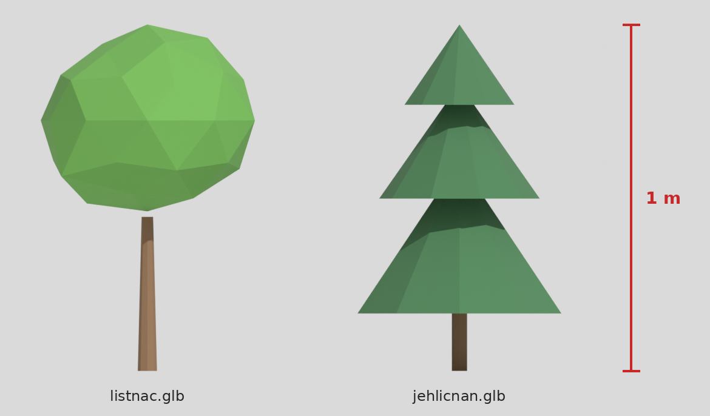
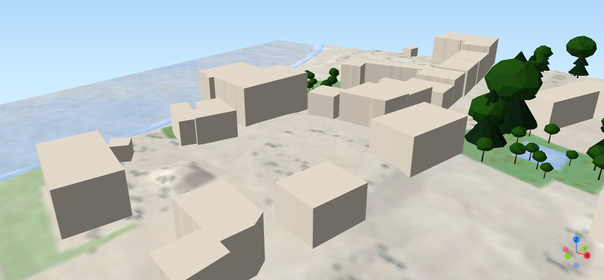

## Příprava dat v&nbsp;ArcGIS Pro
### 1) Zájmová lokalita

1. Mapa projektu musí být v&nbsp;**S-JTSK (EPSG:5514)** – **Map Properties → Coordinate Systems**.
2. Vytvoříme novou vrstvu s&nbsp;výřezem zhruba 300 × 300 m okolo našeho zájmového bodu. **Střed výřezu** si zapíšeme – zadáme ho později v&nbsp;Qgis2threejs jako *Center X* a&nbsp;*Center Y*. Pro Frymburk je to lokální počátek E0 = `-783115`, N0 = `-1197735`, ke kterému je vztažený i&nbsp;model kostela.

!!! tip "&nbsp;<span>Podkladový terén</span>"
    **Terén** můžeme připravit a&nbsp;oříznout už v&nbsp;ArcGIS Pro, ale tuto operaci ponecháme do QGIS, kde je práce s&nbsp;terénem jednodušší. Ušetříme tím čas a&nbsp;nemusíme vytvářet více podkladových dat.

### 2) Land use jako textura

Texturu terénu vytvoříme exportem mapy, ve které je zobrazená jen vrstva land use (se symbologií, kterou chceme vidět na terénu):

1. Zobrazíme pouze vrstvy, které chceme vyexportovat do podkladového terénu (v&nbsp;našem případě tedy land use).
2. Vytvoříme nový Layout, do kterého zobrazíme otevřenou mapu. V&nbsp;Layoutu zobrazíme zájmové území s&nbsp;tím, že samotný výřez ponecháme o&nbsp;něco větší, abychom měli případnou rezervu. Pokud je třeba, nastavíme referenční měřítko.
3. Texturu terénu uložíme ve formátu `PNG` s&nbsp;rozlišením `600 DPI` jako `landuse_frymburk.png`. Před exportem zaškrtneme možnost **Write world file** a&nbsp;jako *Map frame* vybereme mapové pole s&nbsp;územím. Vedle obrázku vznikne soubor `landuse_frymburk.pgw` se souřadnicemi.

!!! tip "&nbsp;<span>Proč export mapy, a&nbsp;ne Polygon to Raster</span>"
    **Polygon to Raster** převede land use na rastr s&nbsp;**kódy tříd**, ne s&nbsp;barvami – v&nbsp;QGIS bychom museli symbologii nastavovat znovu. Některé symboly nelze plně převést do QGISu. Export rastrové mapy uloží přímo to, co vidíme. World file ale **neobsahuje souřadnicový systém** – při importu do QGIS proto musíme ohlídat správné EPSG.

### 3) Budovy

1. Vyfiltrujeme půdorysy budov a&nbsp;pomocí funkce **Clip** je ořízneme pouze v&nbsp;rámci zájmového území. Budovu kostela z&nbsp;vrstvy odstraníme – do scény ho vložíme jako hotový model.
2. Pro vytažení budov do 3D potřebujeme jejich výšku. Nástrojem **Calculate Field** doplníme pole `vyska` (Double), např. z&nbsp;počtu podlaží `!podlazi! * 3 + 2`, nebo jednotnou hodnotou `8`.

### 4) Body stromů

Pro 3D scénu potřebujeme **jednu bodovou vrstvu stromů** s&nbsp;atributy **typ** a&nbsp;**vyska**. Body vytvoříme podle skutečného využití území – v&nbsp;lese, na zahradách a&nbsp;ve stromořadí. V&nbsp;ideálním případě vycházíme z&nbsp;reálného stavu.

1. Pro tvorbu stromů uvnitř ploch použijeme nástroj **Create Random Points**. Plochy jednoho druhu nejdřív vybereme (**Select By Attributes**) a&nbsp;jako *Constraining Feature Class* zadáme vrstvu land use – nástroj použije jen vybrané plochy. Hustotu řídí *Number of Points [value or field]* a&nbsp;*Minimum Allowed Distance* (orientačně les 1 strom na 30 m² a&nbsp;rozestup 4 m, zahrady 1 strom na 60 m² a&nbsp;rozestup 5 m). Pro kresbu stromořadí pak lze využít **Generate Points Along Lines** (*Point Placement* **By Distance**, např. po 8 m).

2. Každé výstupní vrstvě doplníme nástrojem **Calculate Field** pole `typ` (Text) a&nbsp;`vyska` (Double). Náhodu zajistí *Expression Type* **Python**, *Code Block* `import random` a&nbsp;výrazy:

    | Výstup | `typ` | `vyska` |
    |---|---|---|
    | les jehličnatý | `"jehlicnaty" if random.random() < 0.8 else "listnaty"` | `random.uniform(15, 25)` |
    | les listnatý | `"listnaty" if random.random() < 0.8 else "jehlicnaty"` | `random.uniform(15, 25)` |
    | les smíšený | `"jehlicnaty" if random.random() < 0.5 else "listnaty"` | `random.uniform(15, 25)` |
    | zahrady, stromořadí | `"listnaty"` | `random.uniform(6, 12)` |

3. Všechny vrstvy sloučíme nástrojem **Merge** → `stromy`.

### 5) Export do GeoJSON a&nbsp;načtení do QGIS

1. **Features To JSON** zvlášť pro `budovy` a&nbsp;`stromy`:
    - *Output JSON* = `budovy.geojson`, resp. `stromy.geojson`,
    - zaškrtneme **Output to GeoJSON**,
    - **Project to WGS84 nezaškrtáváme** – souřadnice zůstanou v&nbsp;S-JTSK.
2. V&nbsp;QGIS nastavíme projekt do **EPSG:5514** a&nbsp;přetáhneme do něj `landuse_frymburk.png` (soubor `.pgw` musí ležet ve stejné složce), `budovy.geojson` a&nbsp;`stromy.geojson`.
3. **Kontrola souřadnicového systému:** GeoJSON z&nbsp;ArcGIS Pro nese S-JTSK ve značce `crs`, PNG s&nbsp;world filem souřadnicový systém nenese vůbec. Ve vlastnostech každé vrstvy (**Properties → Information**) proto ověříme, že je CRS **EPSG:5514** a&nbsp;vrstvy leží na sobě. Pokud ne, nastavíme ho ručně: pravé tlačítko myši → **Layer CRS → Set Layer CRS…** → EPSG:5514.
4. Jako podkladový terén přidáme historický terén vytvořený z&nbsp;vrstevnic SMO-5. Ten nalezneme zde: `S:\K155\Public\155YDPD\Vltava_2_1.gdb`. Rastr z&nbsp;geodatabáze přetáhneme do QGIS stejně jako ostatní vrstvy a&nbsp;zkontrolujeme, že má **1 pásmo** a&nbsp;CRS **EPSG:5514**.

!!! warning "&nbsp;<span>Terén musí být větší než scéna</span>"
    Qgis2threejs na okraji scény čte výšky i&nbsp;těsně za hranou výřezu. Pokud terén končí přesně na hraně výřezu, okraj terénu spadne do nulové výšky. Terén proto musí přesahovat výřez alespoň o&nbsp;několik metrů.

### 6) Scéna v&nbsp;Qgis2threejs

!!! tip "&nbsp;<span>Instalace pluginu</span>"
    Před začátkem práce je potřeba nainstalovat plugin **Qgis2threejs** (*Plugins → Manage and Install Plugins*).

Qgis2threejs sestaví z&nbsp;vrstev QGIS 3D scénu: terénní rastr vytvoří podklad, vybraná rastrová vrstva land use jeho texturu a&nbsp;vektorové vrstvy 3D objekty.

1. Otevřeme **Web → Qgis2threejs → Qgis2threejs Exporter (WebKit)**.
2. **Scene → Scene Settings:**
    - *Base Extent:* **Fixed extent** → *Center X* `-783115`, *Center Y* `-1197735` (lokální počátek E0, N0 = střed výřezu), *Width* a&nbsp;*Height* `300`,
    - *Origin of xy-plane:* **Center of base extent** – střed výřezu bude v&nbsp;počátku souřadnic SketchUpu,
    - *Z&nbsp;exaggeration:* **1** (bez převýšení).
3. V&nbsp;panelu vrstev exporteru zaškrtneme **terén** z&nbsp;kroku 5 a&nbsp;otevřeme jeho **Properties:**
    - podrobnost sítě: *Resampling level* (Qgis2threejs 2.8) nebo *Grid resolution* (3.x) – pro výřez 300 m stačí střední hodnota,
    - *Material:* tlačítkem **+** → **Select Layer(s)…** vybereme `landuse_frymburk` a&nbsp;výchozí materiál *map (canvas)* odebereme tlačítkem **−**; *Image width* 2048–4096 px,
    - **Build sides** – terén dostane boky a&nbsp;dno jako „blok“; *Bottom* nastavíme kousek pod nejnižší místo terénu, např. `715`.
4. **Budovy:** zaškrtneme vrstvu `budovy`, *Object type* **Extruded**, *Height* = pole `vyska`, *Altitude mode* **Relative to** terénní vrstva.
5. **Stromy:** stáhneme si testovací modely stromů. Oba jsou vysoké přesně **1 m** a&nbsp;počátek mají v&nbsp;patě kmene, takže měřítko = výška stromu v&nbsp;metrech (`vyska` = 22 → strom vysoký 22 m).

    [listnac.glb](../assets/cviceni10/listnac.glb){ .md-button .md-button--primary } [jehlicnan.glb](../assets/cviceni10/jehlicnan.glb){ .md-button .md-button--primary }

    <figure markdown>
    { width="600" }
        <figcaption>Testovací low-poly modely stromů, oba vysoké 1 m</figcaption>
    </figure>

    Modely uložíme do podsložky `stromy` vedle projektu QGIS a&nbsp;projekt uložíme (**Project → Save**). Stromy pak stačí **jedna vrstva** – model se vybere výrazem podle atributu `typ`. V&nbsp;exporteru zaškrtneme vrstvu `stromy` a&nbsp;nastavíme:

    | Nastavení | Hodnota |
    |---|---|
    | *Object type* | **3D Model** |
    | *Model file* | výraz níže – vložíme ho přímo do pole, nebo tlačítkem **ε** vpravo od pole otevřeme editor výrazů |
    | *Scale* | `"vyska"` |
    | *Rotation (z)* | `rand(0, 360)` – každý strom náhodně natočený |
    | *Altitude mode* | **Relative to** terénní vrstva |

    Příklad výrazu pro *Model file*:

    ```sql
    CASE
    WHEN "typ" = 1 THEN 'C:/QGIS_Projects/Vltava_AR_3D/data/stromy/jehlicnaty1.glb'
    WHEN "typ" = 2 THEN 'C:/QGIS_Projects/Vltava_AR_3D/data/stromy/jehlicnaty_strom2.glb'
    WHEN "typ" = 3 THEN 'C:/QGIS_Projects/Vltava_AR_3D/data/stromy/jehlicnaty3.glb'
    WHEN "typ" = 4 THEN 'C:/QGIS_Projects/Vltava_AR_3D/data/stromy/listnaty1.glb'
    WHEN "typ" = 5 THEN 'C:/QGIS_Projects/Vltava_AR_3D/data/stromy/listnaty2.glb'
    END
    ```

    <figure markdown>
{ width="1000" }
    <figcaption>Stromy jako 3D modely v&nbsp;Qgis2threejs: výška podle atributu vyska, náhodné natočení</figcaption>
</figure>


Nastavení exportu si uložíme: **File → Export Settings → Save…**

### 7) Export do SketchUpu a&nbsp;osazení kostela

1. V&nbsp;exporteru **File → Save Scene As → glTF (.gltf, .glb)…** a&nbsp;uložíme jako `teren.glb`.
2. Ve SketchUpu **File → Import**, vybereme `teren.glb`, v&nbsp;**Options** necháme zapnuté **Preserve Drawing Origin**.
3. **Kontrola:**
    - rozměr terénu změříme nástrojem **Tape Measure** – musí odpovídat výřezu (300 m),
    - sever je ve směru **zelené osy**,
    - terén leží ve **skutečné nadmořské výšce** (stovky metrů nad červenou a&nbsp;zelenou osou) – Qgis2threejs posouvá jen polohu, ne výšku.
4. Terén dáme do skupiny s&nbsp;tagem **Teren**, budovy s&nbsp;tagem **Budovy** a&nbsp;stromy s&nbsp;tagem **Stromy**.
5. **Kostel:** **File → Import** → `kostel_sv_bartolomeje.glb`, opět s&nbsp;**Preserve Drawing Origin**. Model má počátek v&nbsp;bodě E0, N0 a&nbsp;nadmořskou výšku, takže se sám posadí na správné místo mezi budovy. Pokud kostel stojí jinde, nebyl při exportu z&nbsp;Qgis2threejs nastaven správný střed výřezu.

