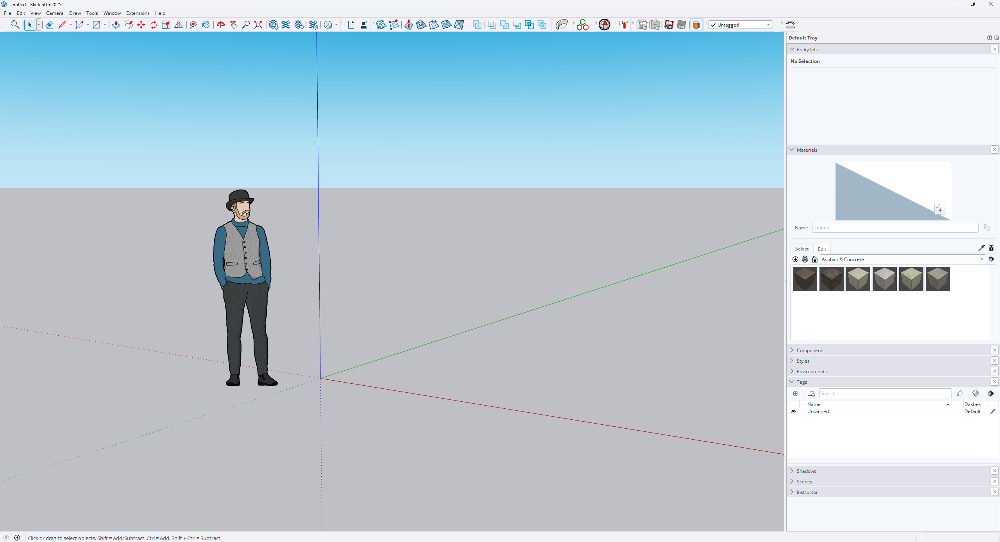
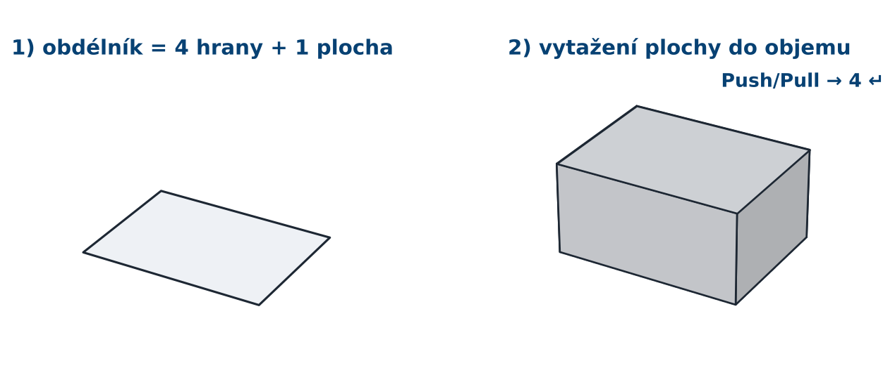
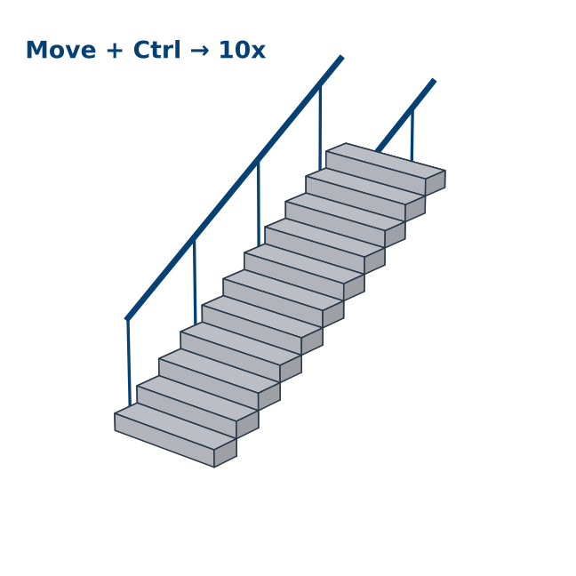
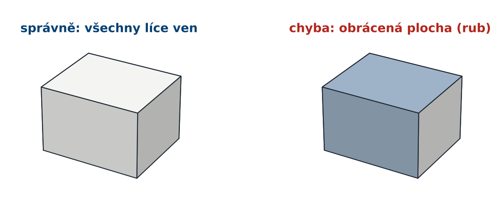
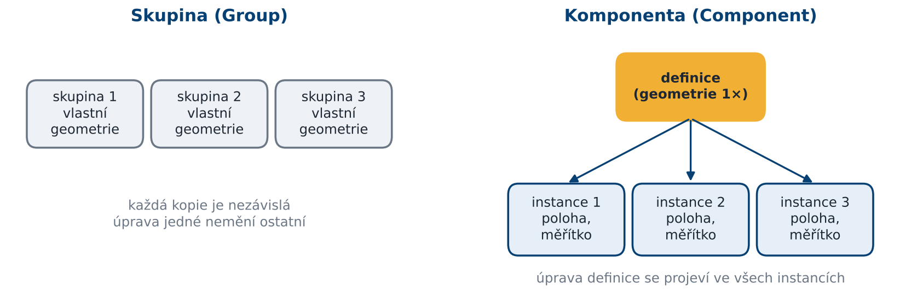

## [Prezentace](https://drive.google.com/file/d/1u9oBMV5WpHh7wxGxwTJlmtRVzYRvhUpt/view?usp=sharing)

## Doporučená literatura

- SketchUp Help Center: [Introducing Drawing Basics and Concepts](https://help.sketchup.com/en/sketchup/introducing-drawing-basics-and-concepts)

- TheSketchUpEssentials: [SketchUp Beginners Start Here!](https://youtube.com/playlist?list=PLEQT0qjXe6zgmMMP6ZzoUDG_fdjcRmCQE&si=4ama5uCd_FLfQpkX)

- Gröger, G., Plümer, L. (2012): [CityGML – Interoperable semantic 3D city models](https://doi.org/10.1016/j.isprsjprs.2012.04.004). ISPRS Journal of Photogrammetry and Remote Sensing, 71, 12–33.

- Janovský, M., Tobiáš, P., Cehák, V. (2022): [3D Visualisation of the Historic Pre-Dam Vltava River Valley—Procedural and CAD Modelling, Online Publishing and Virtual Reality](https://doi.org/10.3390/ijgi11070376). ISPRS International Journal of Geo-Information 2022, 11, 376.

---------

## 1) Prostředí a navigace

Po spuštění SketchUpu vybereme šablonu s jednotkami **v metrech** (v nabídce šablon hledejte „Meters“). Jednotky lze kdykoliv zkontrolovat v **Window → Model Info → Units**. 

<figure markdown>
{ width="1000" }
    <figcaption>Uživatelské rozhraní SketchUpu.</figcaption>
</figure>

Hlavní části rozhraní:

- **Kreslicí plocha** s osami – **červená** (X), **zelená** (Y), **modrá** (Z). Počátek os je bod (0, 0, 0).

- **Panel nástrojů** – vlevo (Large Tool Set) nebo nahoře (Getting Started).

- **Výchozí panel (Default Tray)** vpravo – Entity Info, Materials, Tags, Outliner, Scenes, Styles… Zobrazíme ho přes **Window → Default Tray**.

- **Pole Measurements** (VCB, *Value Control Box*) vpravo dole – sem se **během kreslení píšou přesné rozměry**. Nemusíme do něj klikat, stačí začít psát.

#### Navigace v modelu

| Akce | Ovládání |
|---|---|
| Orbit (otáčení pohledu) | držet **kolečko** |
| Pan (posun pohledu) | Shift + držet **kolečko** |
| Zoom | **otáčet kolečkem** (přibližuje k místu kurzoru) |

!!! tip "&nbsp;Tip"
    Standardní pohledy (shora, zepředu…) najdeme v nabídce **Camera → Standard Views**. Pro práci s podkladem (mapa, ortofoto) se hodí pohled shora a **Camera → Parallel Projection** (bez perspektivy).

## 2) Základní modelovací nástroje

SketchUp pracuje se dvěma typy entit: **hranami** (edges) a **plochami** (faces). Jakmile se hrany uzavřou do rovinného obrazce, SketchUp automaticky vytvoří plochu. Plochu pak nástrojem **Push/Pull** vytáhneme do objemu.

<figure markdown>
{ width="800" }
    <figcaption>Princip modelování ve SketchUpu: uzavřené hrany vytvoří plochu, Push/Pull z ní vytvoří těleso</figcaption>
</figure>

#### Přehled nástrojů

| Nástroj | K čemu slouží |
|---|---|
| Select | výběr; 1× klik = entita, 2× klik = plocha s hranami, 3× klik = celé spojené těleso |
| Line | kreslení hran |
| Rectangle | obdélník (rozměry zadáme jako `12;8`) |
| Circle / Arc | kružnice, oblouk (počet segmentů lze zadat např. `24s`) |
| Push/Pull | vytažení plochy do objemu |
| Offset | rovnoběžná kopie hran plochy (rámy oken, římsy) |
| Move | posun; s Ctrl kopie |
| Rotate | otočení; s Ctrl kopie |
| Scale | změna měřítka |
| Follow Me | vytažení profilu po trase (římsy, okapy, potrubí) |
| Tape Measure | měření vzdáleností a tvorba vodicích čar |
| Eraser | mazání; s Shift skrytí, s Ctrl vyhlazení hran |
| Paint Bucket | přiřazení materiálu |

!!! warning "&nbsp;Desetinná čárka a oddělovač"
    Při českém nastavení systému je desetinným oddělovačem **čárka**. Dvě hodnoty (např. rozměr obdélníku) se proto oddělují **středníkem**: `12,5;8`. Při anglickém nastavení se použije `12.5,8`.

#### Přichytání k ostám či plochám

SketchUp při kreslení uchytí na významné body – koncové body, středy hran, průsečíky, rovnoběžnost a kolmost. Barva vodicí čáry ukazuje, podél které osy kreslíme.

- šipka **→** zamkne kreslení na **červenou** osu, **←** na **zelenou**, **↑** na **modrou**

- podržením Shift zamkneme aktuální směr

#### Kopie a pole

Nástroj **Move** s klávesou Ctrl vytvoří kopii. Ihned poté napíšeme do pole Measurements:

- `5x` – vytvoří 5 kopií se stejnou roztečí,

- `/5` – rozdělí vzdálenost mezi originálem a kopií na 5 dílů.

Takto snadno vytvoříme řadu oken, sloupů nebo stromů.

#### Cvičná úloha: schodiště

1. Nakreslete obdélník `1,2;0,3` (šířka schodu × hloubka stupně).
2. Push/Pull na výšku `0,17`.
3. Vyberte celý schod (trojklik), **Move + Ctrl**, posuňte kopii na horní zadní hranu původního schodu a napište `10x`.
4. Doplňte zábradlí pomocí **Follow Me**: nakreslete kruh o průměru 4 cm kolmo na trasu a nechte ho „projet“ po lomené čáře.

<figure markdown>
{ width="600" }
    <figcaption>Cvičná úloha – schodiště vytvořené kopírováním pomocí pole Measurements</figcaption>
</figure>

#### Normály ploch

Každá plocha má **líc** (bílý, *front face*) a **rub** (modrošedý, *back face*). Pro export do jiných programů (Unity, slicer, renderery) musí **všechny líce mířit ven** z tělesa. Obrácenou plochu opravíme pravým tlačítkem → **Reverse Faces**, případně **Orient Faces** (sjednotí orientaci podle vybrané plochy).

<figure markdown>
{ width="600" }
    <figcaption>Správná a chybná orientace ploch – modrošedý rub signalizuje obrácenou plochu</figcaption>
</figure>

!!! tip "&nbsp;Tip"
    Pro kontrolu orientace přepněte styl na **View → Face Style → Monochrome**. Rub ploch je pak dobře vidět i na otexturovaném modelu.

## 3) Organizace modelu

Geometrie ve SketchUpu se vzájemně přichytává – hrany a plochy, které se dotýkají, se spojí a navzájem rozdělí. Pokud nakreslíme kvádr na jiný kvádr, splynou v jedno těleso. Proto je nutné geometrii **sdružovat do skupin a komponent**.

<figure markdown>
{ width="800" }
    <figcaption>Rozdíl mezi skupinou a komponentou</figcaption>
</figure>

- **Skupina (Group)** – izoluje geometrii; každá kopie je samostatná. Vytvoříme ji výběrem a pravým tlačítkem → **Make Group**.

- **Komponenta (Component)** – geometrie je uložena jednou (*definice*) a v modelu se objevuje jako *instance*. Úprava jedné instance se projeví ve všech. Pravé tlačítko myši → **Make Component**. Vhodné pro okna, dveře, stromy, lampy. Šetří velikost souboru.

- Do skupiny/komponenty vstoupíme **dvojklikem**, ven se dostaneme klávesou Esc nebo do prázdného prostoru.

#### Tagy, Outliner a Entity Info

- **Tags** (vrstvy) – určují **viditelnost** objektů (např. *Budova*, *Podklad*, *Teren*). 

- **Entity Info** – vlastnosti vybrané entity (tag, materiál, u uzavřené skupiny i objem).

#### Materiály a textury

Materiály přiřazujeme nástrojem **Paint Bucket**  z panelu **Materials**. Vlastní texturu (fotografii fasády) vytvoříme v panelu Materials → **Create Material** → načíst obrázek a nastavit jeho skutečné rozměry v metrech. Polohu textury na ploše upravíme pravým tlačítkem → **Texture → Position**.

!!! tip "&nbsp;Tip"
    Materiál přiřazený **skupině** se zobrazí na všech plochách uvnitř, které vlastní materiál nemají (*Default*). Pro jednoduché barvení budov je to nejrychlejší cesta a model zůstane přehledný.
