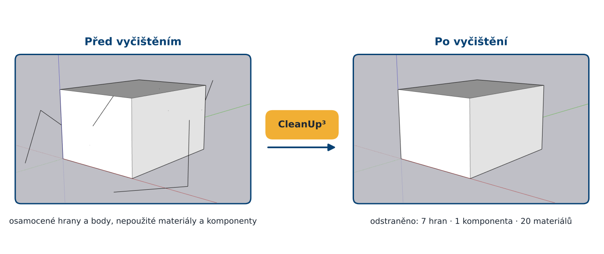
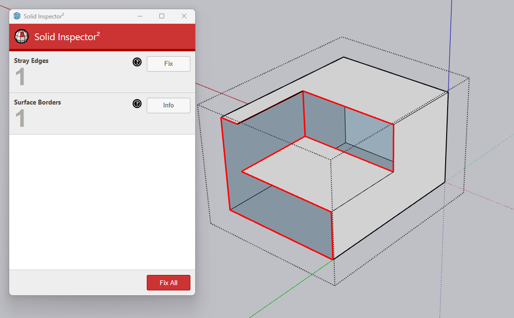
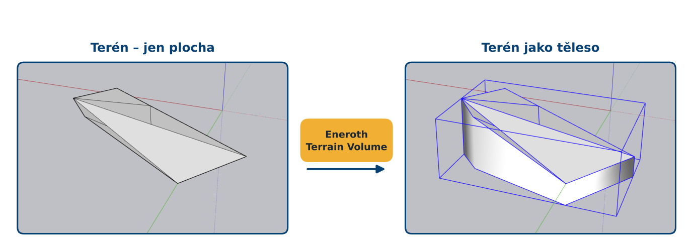
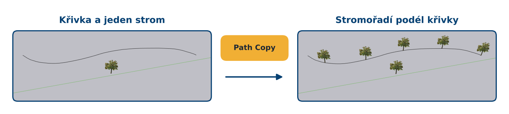
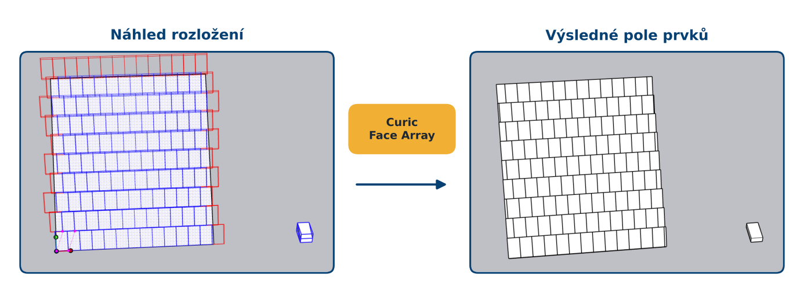
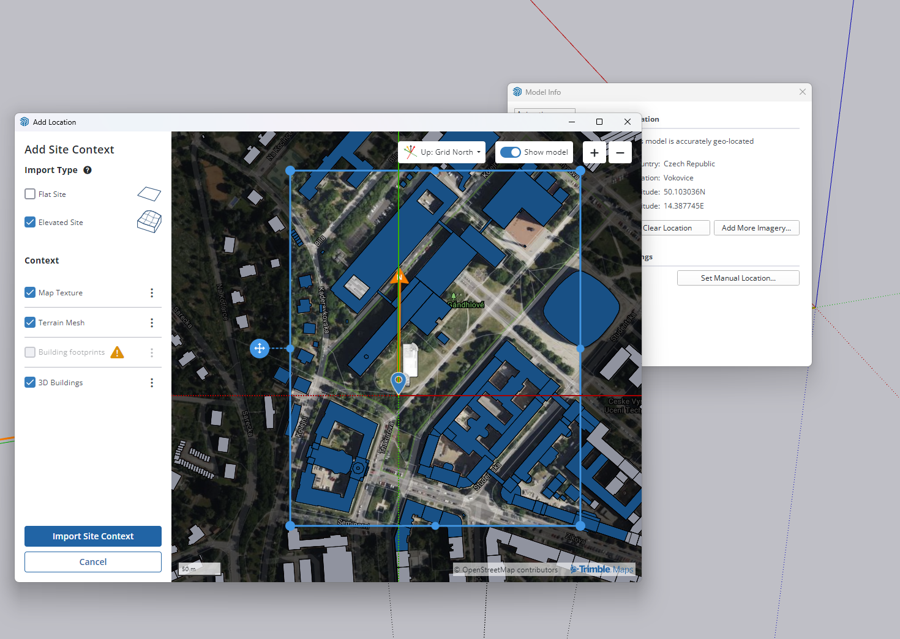

## [Prezentace](https://drive.google.com/file/d/1u9oBMV5WpHh7wxGxwTJlmtRVzYRvhUpt/view?usp=sharing)

## Doporučená literatura

- SketchUp Help Center: [Introducing Drawing Basics and Concepts](https://help.sketchup.com/en/sketchup/introducing-drawing-basics-and-concepts)

- TheSketchUpEssentials: [SketchUp Beginners Start Here!](https://youtube.com/playlist?list=PLEQT0qjXe6zgmMMP6ZzoUDG_fdjcRmCQE&si=4ama5uCd_FLfQpkX)

- Gröger, G., Plümer, L. (2012): [CityGML – Interoperable semantic 3D city models](https://doi.org/10.1016/j.isprsjprs.2012.04.004). ISPRS Journal of Photogrammetry and Remote Sensing, 71, 12–33.

- Janovský, M., Tobiáš, P., Cehák, V. (2022): [3D Visualisation of the Historic Pre-Dam Vltava River Valley—Procedural and CAD Modelling, Online Publishing and Virtual Reality](https://doi.org/10.3390/ijgi11070376). ISPRS International Journal of Geo-Information 2022, 11, 376.

- SketchUp Help Center: [Site Context with Add Location](https://help.sketchup.com/en/site-context-add-location)

- SketchUp Help Center: [Placing Models and Objects on Your Terrain](https://help.sketchup.com/en/sketchup/placing-models-and-objects-your-terrain)

- TheSketchUpEssentials: [The Top 5 FREE SketchUp Extensions Everyone Should Have!:](https://youtu.be/4hEandAPS1k?si=2lptJvnN2ntOMoWb)

---------

## 1) Prostředí a&nbsp;navigace

Po spuštění SketchUpu vybereme šablonu s&nbsp;jednotkami **v&nbsp;metrech** (v&nbsp;nabídce šablon hledejte „Meters“). Jednotky lze kdykoliv zkontrolovat v&nbsp;**Window → Model Info → Units**. 

<figure markdown>
{ width="1000" }
    <figcaption>Uživatelské rozhraní SketchUpu.</figcaption>
</figure>

Hlavní části rozhraní:

- **Kreslicí plocha** s&nbsp;osami – **červená** (X), **zelená** (Y), **modrá** (Z). Počátek os je bod (0, 0, 0).

- **Panel nástrojů** – vlevo (Large Tool Set) nebo nahoře (Getting Started).

- **Výchozí panel (Default Tray)** vpravo – Entity Info, Materials, Tags, Outliner, Scenes, Styles… Zobrazíme ho přes **Window → Default Tray**.

- **Pole Measurements** (VCB, *Value Control Box*) vpravo dole – sem se **během kreslení píšou přesné rozměry**. Nemusíme do něj klikat, stačí začít psát.

#### Navigace v&nbsp;modelu

| Akce | Ovládání |
|---|---|
| Orbit (otáčení pohledu) | držet **kolečko** |
| Pan (posun pohledu) | Shift + držet **kolečko** |
| Zoom | **otáčet kolečkem** (přibližuje k&nbsp;místu kurzoru) |

!!! tip "&nbsp;Tip"
    Standardní pohledy (shora, zepředu…) najdeme v&nbsp;nabídce **Camera → Standard Views**. Pro práci s&nbsp;podkladem (mapa, ortofoto) se hodí pohled shora a&nbsp;**Camera → Parallel Projection** (bez perspektivy).

## 2) Základní modelovací nástroje

SketchUp pracuje se dvěma typy entit: **hranami** (edges) a&nbsp;**plochami** (faces). Jakmile se hrany uzavřou do rovinného obrazce, SketchUp automaticky vytvoří plochu. Plochu pak nástrojem **Push/Pull** vytáhneme do objemu.

<figure markdown>
{ width="800" }
    <figcaption>Princip modelování ve SketchUpu: uzavřené hrany vytvoří plochu, Push/Pull z&nbsp;ní vytvoří těleso</figcaption>
</figure>

#### Přehled nástrojů

| Nástroj | K&nbsp;čemu slouží |
|---|---|
| Select | výběr; 1× klik = entita, 2× klik = plocha s&nbsp;hranami, 3× klik = celé spojené těleso |
| Line | kreslení hran |
| Rectangle | obdélník (rozměry zadáme jako `12;8`) |
| Circle / Arc | kružnice, oblouk (počet segmentů lze zadat např. `24s`) |
| Push/Pull | vytažení plochy do objemu |
| Offset | rovnoběžná kopie hran plochy (rámy oken, římsy) |
| Move | posun; s&nbsp;Ctrl kopie |
| Rotate | otočení; s&nbsp;Ctrl kopie |
| Scale | změna měřítka |
| Follow Me | vytažení profilu po trase (římsy, okapy, potrubí) |
| Tape Measure | měření vzdáleností a&nbsp;tvorba vodicích čar |
| Eraser | mazání; s&nbsp;Shift skrytí, s&nbsp;Ctrl vyhlazení hran |
| Paint Bucket | přiřazení materiálu |

!!! warning "&nbsp;Desetinná čárka a&nbsp;oddělovač"
    Při českém nastavení systému je desetinným oddělovačem **čárka**. Dvě hodnoty (např. rozměr obdélníku) se proto oddělují **středníkem**: `12,5;8`. Při anglickém nastavení se použije `12.5,8`.

#### Přichytání k&nbsp;ostám či plochám

SketchUp při kreslení uchytí na významné body – koncové body, středy hran, průsečíky, rovnoběžnost a&nbsp;kolmost. Barva vodicí čáry ukazuje, podél které osy kreslíme.

- šipka **→** zamkne kreslení na **červenou** osu, **←** na **zelenou**, **↑** na **modrou**

- podržením Shift zamkneme aktuální směr

#### Kopie a&nbsp;pole

Nástroj **Move** s&nbsp;klávesou Ctrl vytvoří kopii. Ihned poté napíšeme do pole Measurements:

- `5x` – vytvoří 5 kopií se stejnou roztečí,

- `/5` – rozdělí vzdálenost mezi originálem a&nbsp;kopií na 5 dílů.

Takto snadno vytvoříme řadu oken, sloupů nebo stromů.

#### Cvičná úloha: schodiště

1. Nakreslete obdélník `1,2;0,3` (šířka schodu × hloubka stupně).
2. Push/Pull na výšku `0,17`.
3. Vyberte celý schod (trojklik), **Move + Ctrl**, posuňte kopii na horní zadní hranu původního schodu a&nbsp;napište `10x`.
4. Doplňte zábradlí pomocí **Follow Me**: nakreslete kruh o&nbsp;průměru 4 cm kolmo na trasu a&nbsp;nechte ho „projet“ po lomené čáře.

<figure markdown>
{ width="600" }
    <figcaption>Cvičná úloha – schodiště vytvořené kopírováním pomocí pole Measurements</figcaption>
</figure>

#### Normály ploch

Každá plocha má **líc** (bílý, *front face*) a&nbsp;**rub** (modrošedý, *back face*). Pro export do jiných programů (Unity, slicer, renderery) musí **všechny líce mířit ven** z&nbsp;tělesa. Obrácenou plochu opravíme pravým tlačítkem → **Reverse Faces**, případně **Orient Faces** (sjednotí orientaci podle vybrané plochy).

<figure markdown>
{ width="600" }
    <figcaption>Správná a&nbsp;chybná orientace ploch – modrošedý rub signalizuje obrácenou plochu</figcaption>
</figure>

!!! tip "&nbsp;Tip"
    Pro kontrolu orientace přepněte styl na **View → Face Style → Monochrome**. Rub ploch je pak dobře vidět i&nbsp;na otexturovaném modelu.

## 3) Organizace modelu

Geometrie ve SketchUpu se vzájemně přichytává – hrany a&nbsp;plochy, které se dotýkají, se spojí a&nbsp;navzájem rozdělí. Pokud nakreslíme kvádr na jiný kvádr, splynou v&nbsp;jedno těleso. Proto je nutné geometrii **sdružovat do skupin a&nbsp;komponent**.

<figure markdown>
{ width="800" }
    <figcaption>Rozdíl mezi skupinou a&nbsp;komponentou</figcaption>
</figure>

- **Skupina (Group)** – izoluje geometrii; každá kopie je samostatná. Vytvoříme ji výběrem a&nbsp;pravým tlačítkem → **Make Group**.

- **Komponenta (Component)** – geometrie je uložena jednou (*definice*) a&nbsp;v&nbsp;modelu se objevuje jako *instance*. Úprava jedné instance se projeví ve všech. Pravé tlačítko myši → **Make Component**. Vhodné pro okna, dveře, stromy, lampy. Šetří velikost souboru.

- Do skupiny/komponenty vstoupíme **dvojklikem**, ven se dostaneme klávesou Esc nebo do prázdného prostoru.

#### Tagy, Outliner a&nbsp;Entity Info

- **Tags** (vrstvy) – určují **viditelnost** objektů (např. *Budova*, *Podklad*, *Teren*). 

- **Entity Info** – vlastnosti vybrané entity (tag, materiál, u&nbsp;uzavřené skupiny i&nbsp;objem).

#### Materiály a&nbsp;textury

Materiály přiřazujeme nástrojem **Paint Bucket**  z&nbsp;panelu **Materials**. Vlastní texturu (fotografii fasády) vytvoříme v&nbsp;panelu Materials → **Create Material** → načíst obrázek a&nbsp;nastavit jeho skutečné rozměry v&nbsp;metrech. Polohu textury na ploše upravíme pravým tlačítkem → **Texture → Position**.

!!! tip "&nbsp;Tip"
    Materiál přiřazený **skupině** se zobrazí na všech plochách uvnitř, které vlastní materiál nemají (*Default*). Pro jednoduché barvení budov je to nejrychlejší cesta a&nbsp;model zůstane přehledný.

## 4) Pluginy

### Extension Warehouse

Funkce SketchUpu lze rozšířit pomocí **extensions** (rozšíření, pluginů) napsaných v&nbsp;jazyce Ruby. Doplňují nástroje, které SketchUp sám nemá: čištění a&nbsp;kontrolu modelu, práci s&nbsp;terénem, kopírování podél křivek, rozmisťování objektů, export do dalších formátů nebo propojení s&nbsp;jinými programy.

Kde pluginy najít:

- **Extension Warehouse** – **Window → Extension Warehouse** (oficiální katalog Trimble, po přihlášení Trimble ID). U&nbsp;každého pluginu je vidět autor, hodnocení, podporované verze SketchUpu a&nbsp;cena.
- **SketchUcation PluginStore** – <https://sketchucation.com/pluginstore> (komunitní katalog, po registraci).
- **Stránky autorů** – soubor `.rbz`, který lze nainstalovat manuálně.

!!! warning "&nbsp;Na co si dát pozor"
    - **Kompatibilita** – u&nbsp;pluginu je uvedeno, pro které verze SketchUpu je určen. Starší pluginy nemusí v&nbsp;novém SketchUpu fungovat.
    - **Licence** – ve výuce používáme **jen pluginy zdarma**. Řada pluginů je placená nebo funguje jen ve zkušební době (v&nbsp;Extension Warehouse - cena nebo označení Trial).
    - **Bezpečnost** – plugin spouští kód v&nbsp;programu i&nbsp;v&nbsp;počítači. Proto je doporučeno instalovat jen z&nbsp;důvěryhodných zdrojů.

### Vybrané základní pluginy

| Plugin | Použití |
|---|---|
| **Sandbox Tools** | tvorba a&nbsp;úprava terénu |
| **CleanUp³** | vyčištění modelu |
| **Solid Inspector²** | nalezení chyb v&nbsp;tělese |
| **Eneroth Terrain Volume** | z&nbsp;plochy terénu vytvoří uzavřené těleso |
| **Path Copy** | kopie komponentu podél křivky |
| **3D Text Editor** | editovatelný 3D text |
| **Flowify** | ohnutí geometrie dle zakřivené linie |
| **Curic Face Array** | rozmístění objektů po ploše |

Všechny uvedené pluginy jsou zdarma. **Sandbox Tools** jsou součástí SketchUpu – jen je zapněte (**View → Toolbars → Sandbox**). Ostatní nainstalujte z&nbsp;Extension Warehouse, Flowify ze [SketchUcation](https://community.sketchucation.com/post/1477550), Path Copy ze stránek [Smustard](http://www.smustard.com/script/PathCopy) a&nbsp;Curic Face Array ze stránek [autora](https://curic.gumroad.com/l/face_array) (při stažení zadejte cenu 0).

#### CleanUp³

Model po importech a&nbsp;úpravách obsahuje nepoužité materiály, osamocené hrany a&nbsp;zbytečně rozdělené plochy. CleanUp³ je odstraní najednou.

1. **Extensions → CleanUp³ → Clean…**
2. V&nbsp;dialogu nechme zapnuté zejména **Purge unused** (nepoužité materiály, komponenty, tagy), **Erase stray edges** (osamocené hrany) a&nbsp;**Merge coplanar faces** (sloučení ploch ležících v&nbsp;jedné rovině).
4. Spustíme a&nbsp;porovnáme počet prvků před a&nbsp;po (**Window → Model Info → Statistics**).

<figure markdown>
{ width="800" }
    <figcaption>Použití pluginu Cleanup.</figcaption>
</figure>

#### Solid Inspector²

Uzavřené těleso (*solid*) je podmínkou pro 3D tisk, booleovské operace (**Tools → Solid Tools**) i&nbsp;pro výpočet objemu.

1. Označíme skupinu prvků a&nbsp;vybereme **Extensions → Solid Inspector²**.
2. Plugin zvýrazní chyby: **díry** (hrany s&nbsp;jednou plochou), **vnitřní plochy** a&nbsp;**osamocené hrany**.
3. Klávesou <kbd>Tab</kbd> přecházíme mezi chybami, <kbd>Enter</kbd> opraví to, co umí plugin opravit sám. Ostatní opravíme ručně (dokreslíme hranu, smažeme vnitřní plochu).

<figure markdown>
{ width="600" }
    <figcaption>Solid Inspector² zvýrazní chyby, kvůli kterým model není uzavřené těleso.</figcaption>
</figure>

#### Eneroth Terrain Volume

Terén ze Sandboxu nebo z&nbsp;Add Location je jen plocha – nemá spodek ani boky, a&nbsp;proto není solid. Eneroth Terrain Volume z&nbsp;něj vytvoří uzavřené těleso.

1. Vybereme skupinu terénu a&nbsp;spustíme příkaz pluginu z&nbsp;menu **Extensions → Eneroth Terrain Volume**.
2. Vznikne těleso s&nbsp;rovným dnem a&nbsp;svislými boky. 

<figure markdown>
{ width="800" }
    <figcaption>Vytvoření uzavřeného terénu z&nbsp;plochy.</figcaption>
</figure>

#### Path Copy

Rozmístí kopie komponentu podél křivky v&nbsp;zadané vzdálenosti (například sloupky plotu podél zdi, lampy podél cesty či stromořadí).

1. Připravíme **trasu** jako jednu souvislou křivku (oblouk nebo spojené hrany). Jednotlivé hrany lze spojit po výběru hran **pravé tlačítko myši → Weld Edges**.
2. Připravíme **komponent** nebo **skupinu** a&nbsp;zkontrolujeme její osy (**right-click → Change Axes**): počátek tam, kde má komponenta stát (pata sloupku), červená osa ve směru trasy.
3. **Extensions → Copy Along Path → Copy to Spacing** a&nbsp;zadáme vzdálenost kopií (např. `2,5`).
4. Klikneme na trasu, potom na komponentu.

<figure markdown>
{ width="800" }
    <figcaption>Rozložení prvku podél křivky.</figcaption>
</figure>

#### 3D Text Editor

Vestavěný nástroj **Tools → 3D Text** vytvoří text, který už nejde upravit – při překlepu ho musíme smazat a&nbsp;napsat znovu. 3D Text Editor vytváří text, který můžeme kdykoli **znovu otevřít a&nbsp;změnit** (obsah, písmo, velikost, hloubku).

1. Spustíme **Extensions → 3D Text Editor** (nebo ikonu v&nbsp;panelu nástrojů).
2. Klikneme na plochu, kam má text přijít (např. podstavec modelu).
3. V&nbsp;dialogu napíšeme text, zvolíme písmo, výšku písmen a&nbsp;hloubku vytažení.
4. Pro úpravu text vybereme a&nbsp;spustíme nástroj znovu.

#### Curic Face Array – rozmístění po ploše

Rozmístí komponent v&nbsp;pravidelném vzoru po celé ploše a&nbsp;ořízne ji podle jejího obrysu.

1. Připravíme komponent nebo skupinu (např. střešní tašku) a&nbsp;plochu (fasáda).
2. **Tools →  Curic** a&nbsp;klikneme na komponentu a&nbsp;potom na plochu.
3. Zadáním hodnot nastavíme rozestupy ve směrech a&nbsp;odsazení od okrajů.
4. Volbou ořezu určíme, co se stane s&nbsp;kopiemi na hranici plochy (zachovat celé/oříznout/vynechat).

<figure markdown>
{ width="800" }
    <figcaption>Rozložení střešních tašek na střeše.</figcaption>
</figure>

!!! tip "&nbsp;Tip"
    U&nbsp;každého pluginu se vyplatí vyhledat návod na internetu, díky kterému se lze dozvědět zajímavé možnosti využití daných pluginů.

## 5) Import půdorysu

Stavbu ideálně kreslíme na základě **půdorysu**, který vložíme jako podklad. Obrázek ale nemá měřítko – určíme ho podle **kót (oměrek)** ve výkresu.

1. **File → Import** → obrázek (JPG, PNG) → volba **Use as Image** → prvním klikem do počátku os, druhým klikem určíme přibližnou velikost.
2. Obrázek převedeme na skupinu (**pravé tlačítko myši → Make Group**) a&nbsp;dvojklikem ji otevřeme k&nbsp;editaci.
3. Nástrojem **Tape Measure** (<kbd>T</kbd>) klikneme na začátek a&nbsp;konec kótované vzdálenosti z&nbsp;výkresu, napíšeme skutečnou hodnotu (např. `5`) a&nbsp;potvrdíme <kbd>Enter</kbd>. Na dotaz **Resize the group?** odpovíme *Yes*. Změní se jen skupina s&nbsp;obrázkem, ne celý model.
4. **Kontrola**: změříme **další kótu v&nbsp;kolmém směru**. Pokud nesedí, je sken zkreslený – obrázek v&nbsp;tom směru doupravíme nástrojem **Scale** (táhneme za boční úchop a&nbsp;zadáme poměr, např. `1,02`).
5. **Natočení**: nástrojem **Rotate** natočíme půdorys tak, aby hlavní zdi ležely na červené a&nbsp;zelené ose – kreslení po osách je pak mnohem snazší.
6. Skupině půdorysu přiřadíme tag **Podklady** a&nbsp;zamkneme ji (**pravé tlačítko myši → Lock**), aby se při kreslení nepohnula.

!!! tip "&nbsp;Tip"
    Podklad prosvítá lépe, když v&nbsp;**Window → Default Tray → Styles → Edit → Face Settings** zapneme **Enable transparency** a&nbsp;materiálu obrázku snížíme neprůhlednost (*Opacity*).

!!! tip "&nbsp;Půdorys z&nbsp;DWG/DXF"
    Pokud máme výkres v&nbsp;**CAD formátu**, vložíme ho přes **File → Import** → *AutoCAD Files (DWG, DXF)*. V&nbsp;**Options** nastavíme jednotky (**Meters** nebo **Millimeters** podle výkresu), volbu **Preserve drawing origin** a&nbsp;**Merge coplanar faces**. Výhoda: linie mají **přesné rozměry** a&nbsp;měřítko neurčujeme. Vrstvy z&nbsp;CADu se převedou na **tagy** – nepotřebné (kóty, šrafy, texty) skryjeme nebo smažeme. Linie zdí pak stačí obkreslit nebo z&nbsp;nich nechat vytvořit plochy a&nbsp;vytáhnout je.

## 6) Kresba stavby podle půdorysu

Doporučení postup pro tvorbu 3D modelu:

1. **Obvodové zdi** – nástrojem **Line** nebo **Rectangle** obkreslíme vnější obrys stavby. Tloušťku zdí vytvoříme nástrojem **Offset** (<kbd>F</kbd>) – klikneme na plochu a&nbsp;zadáme tloušťku, např. `0,8`. U&nbsp;historických staveb mají zdi často různou tloušťku – kreslíme podle půdorysu.
2. **Vytažení** – plochu zdí vytáhneme nástrojem **Push/Pull** do výšky okapu (odhad z&nbsp;fotografií nebo z&nbsp;řezu). Zdi převedeme na skupinu.
3. **Otvory** – na fasádu nakreslíme obdélník okna nebo dveří (podle půdorysu a&nbsp;fotografií) a&nbsp;nástrojem **Push/Pull** ho protlačíme do tloušťky zdi – otvor projde skrz. Půlkruhové prvky nakreslíme nástrojem **Arc**.
4. **Okna jako komponenty** – rám okna vymodelujeme jednou jako komponent. Komponent se může přilepit na plochu a&nbsp;vyříznout otvor (**Glue to** a&nbsp;**Cut opening** v&nbsp;dialogu *Make Component*). Kopie pak rozmístíme nástrojem **Move** s&nbsp;<kbd>Ctrl</kbd> nebo pluginem **Curic Face Array**.
5. Nakreslíme střechu, přičemž přesah střechy vytvoříme nástrojem **Offset** horní plochy zdí před tvorbou střechy.
6. Přidáme detaily a&nbsp;dveře. Nakonec zkontrolujeme normály (styl *Monochrome*) a&nbsp;tělesa v&nbsp;**Solid Inspectoru²**. Závěrem můžeme použíj CleanUp³ pro odmazání nepotřebné geometrie.

!!! tip "&nbsp;Výšky bez řezu"
    Pokud nemáme řez ani pohledy, odhadneme rozměry a&nbsp;poměry prvků budovy z&nbsp;fotografií.

## 7) Pokročilá práce s&nbsp;texturami

Textury lze najít ve veřejných repozitářích, případně vytvořit vlastní z&nbsp;fotografie. Ideální je použít **bezešvé textury**:

- [Poly Haven](https://polyhaven.com/textures)

- [ambientCG](https://ambientcg.com/)

### Vlastní materiál ve SketchUpu

1. Otevřeme **Window → Default Tray → Materials** a&nbsp;klikneme na **Create Material** (ikona +).
2. Pojmenujeme materiál (např. *kamen_zdivo*), zaškrtneme **Use texture image** a&nbsp;vybereme obrázek.
3. Nastavíme **skutečnou velikost** jednoho opakování textury, např. šířku `2 m` (podle toho, jak velkou plochu obrázek zachycuje).
4. Můžeme přidat i&nbsp;mapy **Roughness** (drsnost) a&nbsp;**Normal** (nerovnosti) ze sady PBR. Povrch pak realisticky reaguje na světlo.
5. Materiál naneseme nástrojem **Paint Bucket** (<kbd>B</kbd>).
6. Vlastní materiály uložíme do kolekce (**Materials → Details → Save Collection As**), abychom je mohli použít i&nbsp;v&nbsp;další práci.

### Práce s&nbsp;texturou

- **Posun, otočení, měřítko** – **pravým tlačítkem myši na plochu → Texture → Position**. Táhnutím barevných špendlíků texturu posuneme (červený), otočíme a&nbsp;změníme měřítko (zelený), zkosíme (modrý) nebo deformujeme (žlutý).
- **Navázání textury** – kapátkem (<kbd>Alt</kbd> + Paint Bucket) nabereme texturu i&nbsp;s&nbsp;natočením a&nbsp;naneseme ji na sousední plochu – textura plynule pokračuje přes roh.
- **Zakřivené plochy** – na válce a&nbsp;oblouky nanášíme texturu jako **projektovanou**: nastavíme ji na rovinnou plochu, **pravé tlačíko myši → Texture → Projected**, nabereme ji kapátkem a&nbsp;natřeme zakřivenou plochu. Textura se takto nebude lámat na jednotlivých segmentech.

!!! tip "&nbsp;Tip – Match Photo"
    SketchUp umí fotografii na model **promítnout** přímo: **Camera → Match New Photo**, zarovnáme osy podle hran budovy na fotce a&nbsp;pak **pravým tlačítkem myši na plochu → Project Photo**. Hodí se pro celou fasádu včetně oken.

## 8) Terén

### Geolokace a&nbsp;terén přímo ve SketchUpu

SketchUp umí model umístit na kamkoliv na Zemi a&nbsp;stáhnout k&nbsp;němu mapový podklad, terén i&nbsp;okolní budovy.

1. **File → Geo-location → Add Location…** a&nbsp;přihlásíme se Trimble ID.
2. Vyhledáme adresu stavby. Model se geolokalizuje a&nbsp;jeho poloha se uloží do **Window → Model Info → Geo-location**. Od té doby odpovídá skutečnosti i&nbsp;**poloha slunce a&nbsp;stíny**.
3. Klikneme na **Import Context**. Na mapě se objeví modrý rámeček – posuneme ho a&nbsp;změníme jeho velikost tak, aby pokryl zájmové území podle potřeby.
4. Nastavíme možnosti importu:

| Volba | Možnosti | Doporučení |
|---|---|---|
| **Import Type** | *Flat Site* (mapa v&nbsp;rovině), *Elevated Site* (mapa na terénu) | *Elevated Site* |
| **Map Texture** | *Satellite Imagery* (Bing / Digital Globe) nebo *Street Map*; rozlišení *High / Medium / Low* | satelitní snímek, rozlišení **High** |
| **Terrain Mesh** | hustota sítě terénu (jen u&nbsp;*Elevated Site*) | **střední** – vyšší hustota = více trojúhelníků a&nbsp;větší soubor |
| **3D Buildings** | okolní budovy jako jednoduché bloky; usazení podle nejvyššího / nejnižšího bodu terénu, s&nbsp;podezdívkou | |

5. Klikneme na **Import Site Context**. Do modelu se vloží skupiny s&nbsp;mapou, terénem a&nbsp;budovami ve vlastních tazích (*Geolocation Content*). Mezi rovinou a&nbsp;terénem přepínáme viditelností tagů.

<figure markdown>
{ width="800" }
    <figcaption>Geolokalizace modelu.</figcaption>
</figure>

### Příprava terénu pro úpravy

Nástroje Sandbox pracují jen s&nbsp;terénem, který splňuje několik podmínek:

- **Jedna plocha z&nbsp;trojúhelníků** – terén je souvislá síť (TIN).
- **Skupina, která není zamčená** – importovaný terén z&nbsp;Add Location bývá **zamčený**. Odemkneme ho (**pravé tlačítko myši → Unlock**). Nástroje Stamp a&nbsp;Drape pracují se skupinou terénu jako celkem, Smoove uvnitř skupiny.
- **Dostatečně hustá síť** – Smoove posouvá vrcholy sítě. V&nbsp;místě, které chceme tvarovat, musí být dost vrcholů – řídkou síť zahustíme nástrojem **Add Detail**.
- **Bez textury pro úpravy** – textura snímku se při úpravách deformuje. Je lepší upravovat terén bez textury a&nbsp;snímek na něj promítnout až potom (**Projected** textura).

### Úpravy terénu nástroji Sandbox

Panel nástrojů zapneme přes **View → Toolbars → Sandbox**.

| Nástroj | K&nbsp;čemu | Postup |
|---|---|---|
| **Smoove** | plynulé zvednutí nebo snížení terénu (val, prohlubeň, úprava svahu) | vstoupíme do skupiny terénu, zadáme poloměr (např. `10`), klikneme do terénu, táhneme nahoru nebo dolů a&nbsp;klikneme znovu; výšku můžeme napsat |
| **Stamp** | vodorovná plošina pod stavbou | stavbu postavíme nad terén, vybereme nástroj, klikneme na stavbu, zadáme přesah (např. `1`), klikneme na terén, posuneme plošinu na výšku a&nbsp;klikneme |
| **Drape** | promítnutí hran (cesty, obrysy) na terén | obrysy nakreslíme nad terén, vybereme je, zvolíme nástroj a&nbsp;klikneme na terén – hrany rozdělí plochy terénu a&nbsp;cestu pak natřeme jiným materiálem |
| **Add Detail** | zahuštění sítě v&nbsp;části terénu | vybereme plochy terénu a&nbsp;klikneme na nástroj |
| **Flip Edge** | otočení diagonály trojúhelníku | klikneme na hranu – opraví „zuby“ v&nbsp;terénu |

!!! tip "&nbsp;Další možnosti, jak získat terén"
    - **Vrstevnice z&nbsp;DWG/DXF** – v&nbsp;QGIS z&nbsp;DMR 5G vytvoříme vrstevnice (**Raster → Extraction → Contour**, volba *Produce 3D vector*), posuneme je k&nbsp;lokálnímu počátku (**Processing → Vector geometry → Translate**) a&nbsp;uložíme jako DXF. Ve SketchUpu je importujeme (**File → Import**, jednotky *Meters*, *Preserve drawing origin*), vybereme a&nbsp;použijeme **Draw → Sandbox → From Contours**. Vznikne přesný terén, se kterým nástroje Sandbox pracují bez omezení.
    - **GLB z&nbsp;QGIS (plugin Qgis2threejs)** – z&nbsp;rastru DMR 5G a&nbsp;ortofota vytvoří texturovaný terén. Ve **Scene Settings** nastavíme *Origin of xy-plane: Center of base extent* a&nbsp;*Vertical exaggeration 1*, uložíme **File → Save Scene As → glTF (.glb)** a&nbsp;ve SketchUpu importujeme přes **File → Import**. Ortofoto je už na terénu správně namapované.
    - **Plugin Bitmap To Mesh** – vytvoří terén z&nbsp;**výškové mapy** (šedotónový obrázek, světlejší = výš): **Draw → Mesh From Heightmap**, zadáme rozměr a&nbsp;výškový rozsah. Výškovou mapu můžeme vyexportovat z&nbsp;QGIS. Každý pixel dá dva trojúhelníky – obrázek 250 × 250 px vytvoří kolem 125 000 ploch, používáme proto malé obrázky.

    Všechna data z&nbsp;GIS musí mít stejný **lokální počátek** – souřadnice S-JTSK jsou příliš velké a&nbsp;SketchUp by ztrácel přesnost.