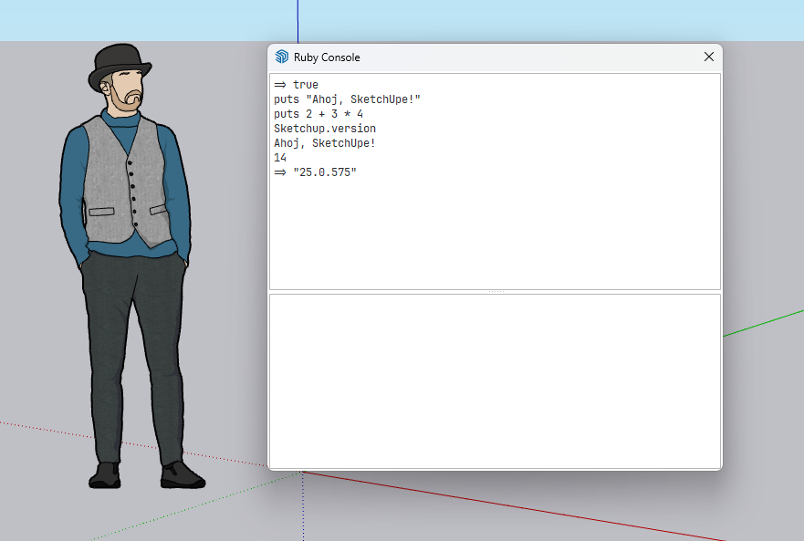
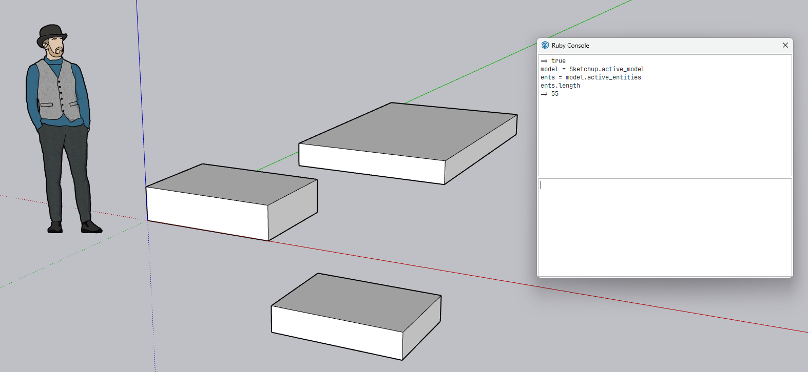
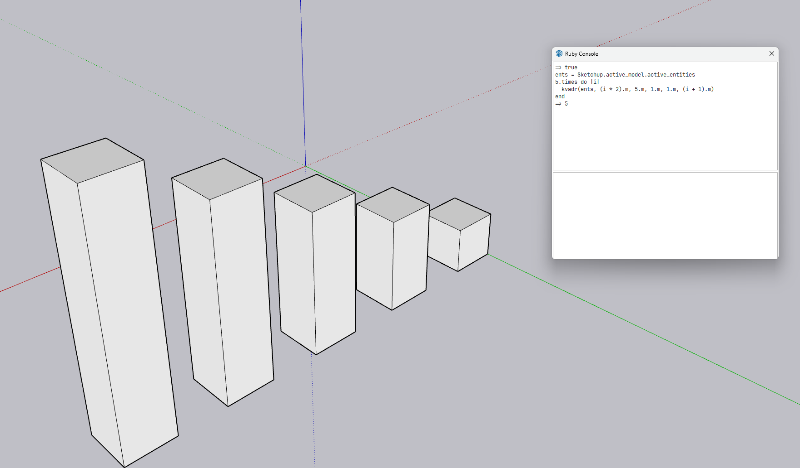
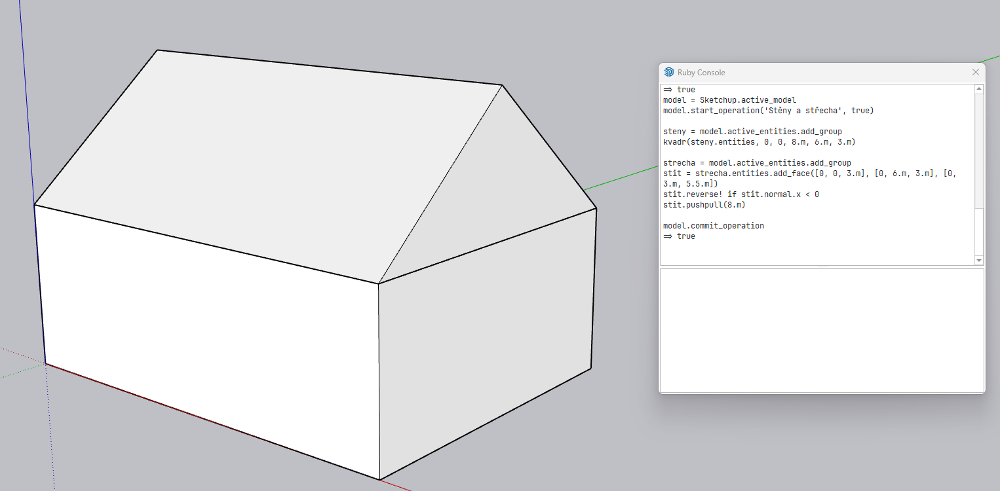
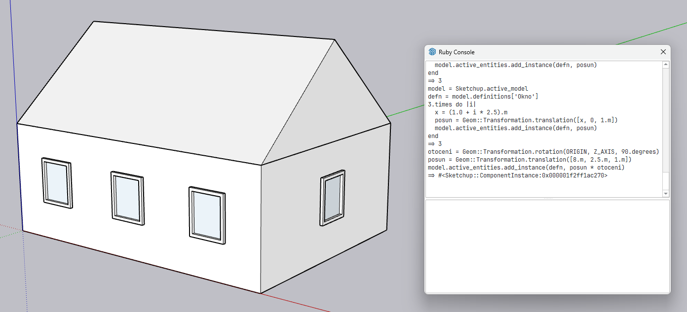
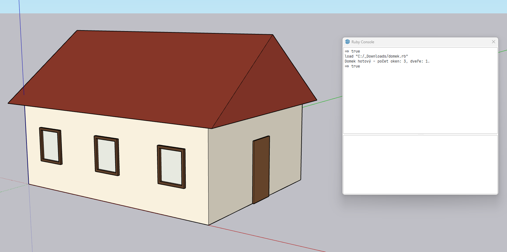
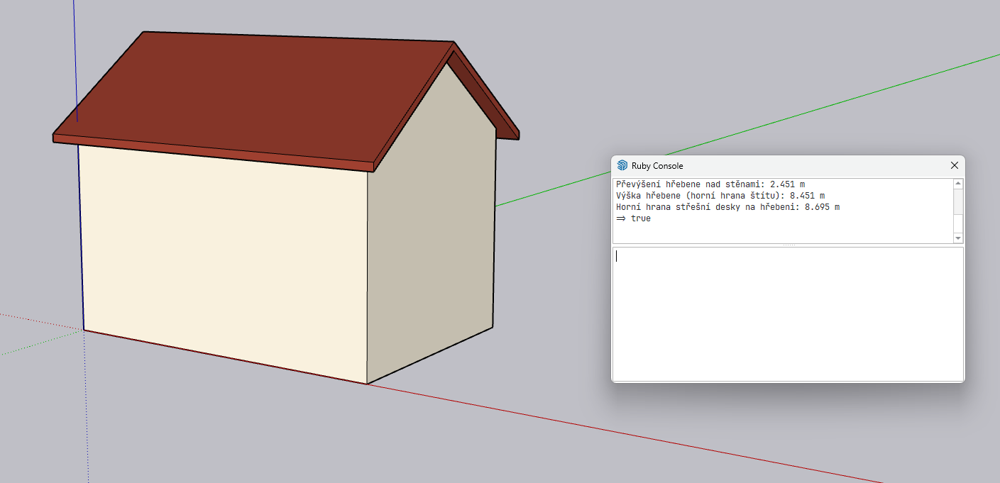
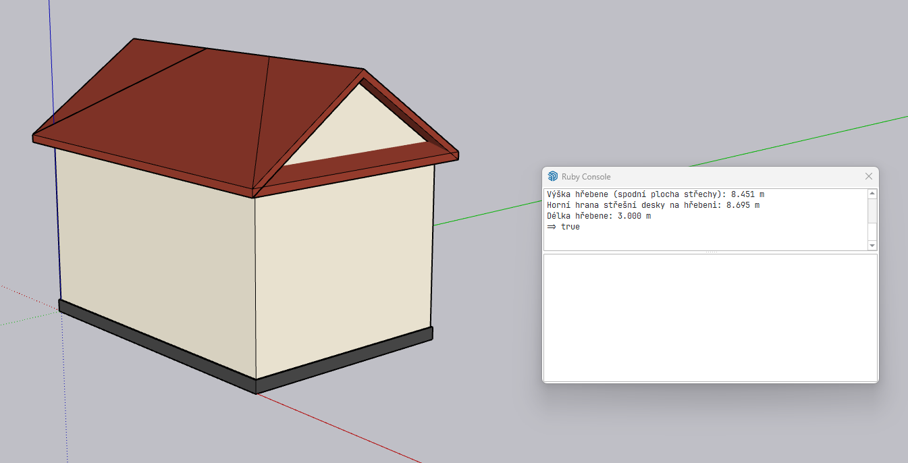
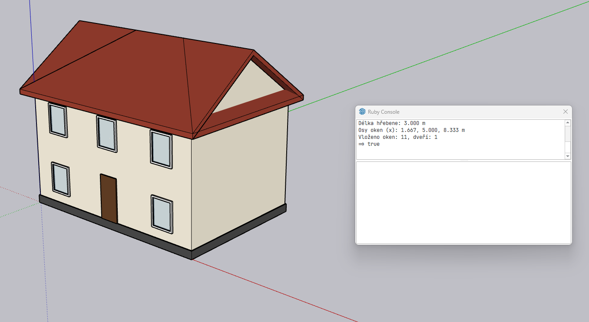
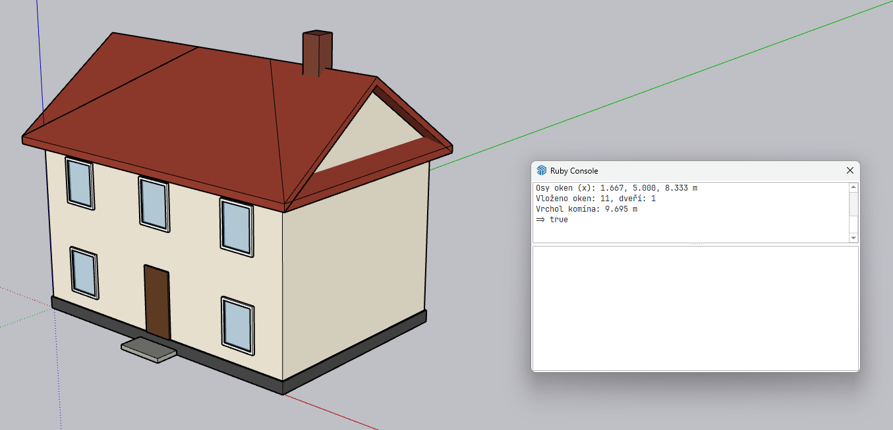

## [Prezentace](https://drive.google.com/file/d/1HxFX59fEejS9Rxufiz-G-eG4pglopkq1/view?usp=sharing)

## Doporučená literatura

- SketchUp Ruby API: [Dokumentace](https://ruby.sketchup.com/)

- SketchUp Help Center: [SketchUp AI](https://help.sketchup.com/en/ai-features)

- TheSketchUpEssentials: [ChatGPT-6 Astra - Real 3D Model or Just AI Slop?](https://youtu.be/ixYN2rCRGTM?si=SP8O9JRsMG49MZPO)

- The AI Essentials: [How to Connect AI to SketchUp (Complete MCP Setup Tutorial)](https://youtu.be/9DnrSvAYKsI?si=l3WbRSfnqgqjZ88o)

---------

!!! warning "&nbsp;<span>Ochrana dat</span>"
    Do online AI nástrojů nenahráváme data, která nesmíme sdílet (projekty pro zadavatele, neveřejné plány, osobní údaje, fotografie lidí).

## 1) Základy Ruby ve SketchUpu

SketchUp má zabudovaný jazyk **Ruby** a&nbsp;k&nbsp;němu **Ruby API** – sadu příkazů, kterými můžeme kreslit hrany a&nbsp;plochy, vytahovat je, vytvářet skupiny, komponenty, materiály a&nbsp;tagy. Skript se vyplatí zejména při **opakovaných** činnostech (řada oken, sloupy, budovy z&nbsp;tabulky) nebo kde chceme model snadno **změnit parametrem**.

### 1.1 Ruby konzole

Ruby konzoli otevřeme v&nbsp;menu **Extensions → Developer → Ruby Console** (ve starších verzích **Window → Ruby Console**). Okno má dvě části: nahoře se vypisují výsledky, dole je řádek, kam píšeme příkazy. Příkaz potvrdíme klávesou <kbd>Enter</kbd>.

Vyzkoušíme první příkazy – každý napíšeme a&nbsp;potvrdíme zvlášť:

```ruby
puts "Ahoj, SketchUpe!"
puts 2 + 3 * 4
Sketchup.version
```
<figure markdown>
{ width="600" }
    <figcaption>Výstup z konzole.</figcaption>
</figure>

- `puts` vypíše text do konzole.
- Konzole funguje i&nbsp;jako kalkulačka – vrátí `14`.
- `Sketchup.version` vypíše verzi SketchUpu.

!!! tip "&nbsp;<span>Delší kód v&nbsp;konzoli</span>"
    Do spodního řádku konzole můžeme vložit i&nbsp;**více řádků najednou** (zkopírujeme celý blok kódu z&nbsp;tohoto návodu a&nbsp;vložíme ho <kbd>Ctrl</kbd> + <kbd>V</kbd>). Delší skripty ale budeme ukládat do souboru – viz krok [1.10](#110-skript-v-souboru-domek-z-komponent).

Výstupy konzole můžeme **smazat** příkazem ```SKETCHUP_CONSOLE.clear```.
    

### 1.2 Model, entity a&nbsp;jednotky

Všechno, co je v&nbsp;modelu, je dostupné přes objekt `Sketchup.active_model` – aktuálně otevřený model. Geometrie (hrany, plochy či skupiny) leží v&nbsp;kolekci **entities**.

```ruby
model = Sketchup.active_model
ents = model.active_entities
ents.length
```
<figure markdown>
{ width="800" }
    <figcaption>Výstup z konzole.</figcaption>
</figure>

- `model = …` uloží model do **proměnné** `model`, abychom ho nemuseli pokaždé vypisovat celý.
- `active_entities` jsou entity v&nbsp;**aktuálně otevřeném kontextu** – v&nbsp;modelu nebo uvnitř skupiny, kterou máme otevřenou k&nbsp;editaci.
- `ents.length` vypíše, kolik entit model obsahuje.

!!! warning "&nbsp;<span>Jednotky: vždy `.m`</span>"
    SketchUp interně počítá v&nbsp;**palcích**, a&nbsp;to bez ohledu na šablonu modelu. Číslo `2` je pro Ruby API 2 palce (5,08 cm)! Metry zapíšeme příponou `.m` – například `2.m`, `0.4.m` nebo `(sirka / 2).m`. Desetinná čísla píšeme v&nbsp;Ruby vždy s&nbsp;**tečkou**.

### 1.3 Kresba krychle a kvádru

Kostku vytvoříme stejně jako myší: nakreslíme čtverec a&nbsp;vytáhneme ho do výšky.

```ruby
model = Sketchup.active_model
ents = model.active_entities
face = ents.add_face([0, 0, 0], [2.m, 0, 0], [2.m, 2.m, 0], [0, 2.m, 0])
face.reverse! if face.normal.z < 0
face.pushpull(2.m)
```

Co který řádek dělá:

1. `add_face` vytvoří plochu ze čtyř bodů. Každý bod je trojice `[x, y, z]`. Hrany se dokreslí automaticky.
2. Plocha ležící na zemi má ve SketchUpu líc otočený **dolů**. `face.normal` je normála plochy (směr líce); pokud míří dolů (`z < 0`), plochu otočíme `reverse!`.
3. `pushpull(2.m)` vytáhne plochu o&nbsp;2 m **ve směru normály** – tedy nahoru.

Kostku si prohlédněte, zkuste ji vybrat a&nbsp;podívejte se do **Entity Info**. Pak ji smažte (nebo vraťte <kbd>Ctrl</kbd> + <kbd>Z</kbd>).

!!! question "&nbsp;<span>Vyzkoušejte</span>"
    1. Co se stane, když vynecháte řádek s&nbsp;`reverse!`?
    2. Upravte kód tak, aby vznikl kvádr 3 × 1 × 5 m.
    3. Co se stane, když v&nbsp;souřadnicích zapomenete `.m`?

### 1.4 Tvorba metody (funkce)

Abychom stejný kód nepsali stále dokola, zabalíme ho do **metody** (funkce). Metoda má jméno a&nbsp;**parametry** – hodnoty, které jí při zavolání předáme.

```ruby
def kvadr(ents, x, y, sirka, hloubka, vyska)
  f = ents.add_face([x, y, 0], [x + sirka, y, 0],
                    [x + sirka, y + hloubka, 0], [x, y + hloubka, 0])
  f.reverse! if f.normal.z < 0
  f.pushpull(vyska)
end
```

Metodu nejdřív vložíme do konzole (tím ji SketchUp „pozná“) a&nbsp;pak ji voláme:

```ruby
ents = Sketchup.active_model.active_entities
kvadr(ents, 0, 0, 2.m, 3.m, 1.m)
kvadr(ents, 4.m, 0, 1.m, 1.m, 4.m)
```

- `def … end` ohraničuje metodu.
- Parametry `x, y` určují levý přední roh, `sirka, hloubka, vyska` rozměry.

### 1.5 Cyklus: řada kvádrů

Opakování zapíšeme **cyklem**. `5.times do |i| … end` provede blok pětkrát a&nbsp;v&nbsp;proměnné `i` postupně dostane hodnoty 0, 1, 2, 3, 4.

```ruby
ents = Sketchup.active_model.active_entities
5.times do |i|
  kvadr(ents, (i * 2).m, 5.m, 1.m, 1.m, (i + 1).m)
end
```
Vznikne pět sloupků vzdálených 2 m, vysokých 1 až 5 m. Stejným principem můžeme rozmístit okna, sloupy nebo stromy.

<figure markdown>
{ width="800" }
    <figcaption>Vykreslení kvádrů.</figcaption>
</figure>

!!! question "&nbsp;<span>Vyzkoušejte</span>"
    Upravte cyklus tak, aby vzniklo 10 sloupků 0,4 × 0,4 × 3 m po 2,5 m.

### 1.6 Skupiny, materiály a&nbsp;jeden krok Undo

Zkusíme nakreslit tři kvádry těsně vedle sebe: `kvadr(ents, 0, 10.m, 1.5.m, 1.5.m, 1.m)` a&nbsp;totéž pro `x = 1.5.m` a&nbsp;`x = 3.m`. Kvádry **splynou** – sdílejí stěny a&nbsp;SketchUp je spojí do jednoho tvaru. Stejně jako při ruční práci proto geometrii spojíme do **skupin**.

```ruby
model = Sketchup.active_model
model.start_operation('Kvádry ve skupinách', true)

cervena = model.materials.add('Cervena')
cervena.color = 'red'

3.times do |i|
  g = model.active_entities.add_group
  kvadr(g.entities, (i * 1.5).m, 10.m, 1.5.m, 1.5.m, 1.m)
  g.material = cervena
  g.name = "Kvadr #{i + 1}"
end

model.commit_operation
```

- `add_group` vytvoří prázdnou skupinu, kvádr pak kreslíme do **jejích** entit (`g.entities`).
- `g.material` obarví celou skupinu, `g.name` ji pojmenuje (viz **Outliner**).
- `"Kvadr #{i + 1}"` – výraz ve složených závorkách se do textu dosadí.
- `start_operation` a&nbsp;`commit_operation` sbalí celý skript do **jednoho kroku Undo** – jedním <kbd>Ctrl</kbd> + <kbd>Z</kbd> vrátíme vše.

!!! note "&nbsp;<span>Poznámka</span>"
    `materials.add('Cervena')` při druhém spuštění vytvoří nový materiál *Cervena1*. Ve skriptech proto nejdřív zkusíme materiál najít: `model.materials['Cervena'] || model.materials.add('Cervena')`. Stejně to platí pro tagy (`model.layers`).

### 1.7 Sedlová střecha

Střechu vytvoříme jako **trojúhelník (štít)**, který vytáhneme po celé délce domu. Postavíme si nejdřív stěny domku 8 × 6 × 3 m a&nbsp;pak střechu s&nbsp;hřebenem ve výšce 5,5 m:

```ruby
model = Sketchup.active_model
model.start_operation('Stěny a střecha', true)

steny = model.active_entities.add_group
kvadr(steny.entities, 0, 0, 8.m, 6.m, 3.m)

strecha = model.active_entities.add_group
stit = strecha.entities.add_face([0, 0, 3.m], [0, 6.m, 3.m], [0, 3.m, 5.5.m])
stit.reverse! if stit.normal.x < 0
stit.pushpull(8.m)

model.commit_operation
```

<figure markdown>
{ width="800" }
    <figcaption>Vytvoření jednoduchého domu se sedlovou střechou.</figcaption>
</figure>

- Trojúhelník leží ve svislé rovině `x = 0` (štítová stěna), vrchol je uprostřed hloubky domu.
- Normála štítu má mířit ve směru osy **X** (do domu), proto kontrolujeme `normal.x`.
- `pushpull(8.m)` vytáhne štít přes celou šířku domu – vznikne hranol střechy.

### 1.8 Komponenta: okno

Okno na domě bude několikrát. Každé okno jako samostatná skupina by zbytečně zvětšovalo soubor a&nbsp;při změně bychom museli upravovat každé zvlášť. Proto použijeme **komponentu**: geometrie je v&nbsp;modelu uložená jednou (**definice**) a&nbsp;v&nbsp;modelu se objevuje jako **instance**.

```ruby
model = Sketchup.active_model
defn = model.definitions.add('Okno')
e = defn.entities

ram  = e.add_face([0, 0, 0], [1.m, 0, 0], [1.m, 0, 1.2.m], [0, 0, 1.2.m])
sklo = e.add_face([0.08.m, 0, 0.08.m], [0.92.m, 0, 0.08.m],
                  [0.92.m, 0, 1.12.m], [0.08.m, 0, 1.12.m])
ram.reverse! if ram.normal.y > 0
ram.pushpull(0.08.m)

sklo_mat = model.materials['Sklo'] || model.materials.add('Sklo')
sklo_mat.color = Sketchup::Color.new(150, 190, 220)
sklo_mat.alpha = 0.4
sklo.material = sklo_mat
```

- `definitions.add('Okno')` vytvoří definici komponenty. Zatím ji v&nbsp;modelu **nevidíme** – najdeme ji v&nbsp;panelu **Components → In Model**.
- Okno kreslíme ve svislé rovině `y = 0` (stejně jako přední fasáda) s&nbsp;počátkem v&nbsp;levém dolním rohu.
- Druhá plocha (`sklo`) uvnitř první z&nbsp;ní „vykrojí“ otvor: z&nbsp;první plochy zůstane rám.
- Rám vytáhneme o&nbsp;8 cm **ven** z&nbsp;fasády (proti ose Y), sklo zůstane zapuštěné.
- `alpha = 0.4` nastaví průhlednost materiálu.

### 1.9 Vložení a&nbsp;otočení instancí

Instanci vložíme metodou `add_instance`. Kromě definice potřebuje **transformaci** – kam a&nbsp;jak natočenou instanci umístit.

```ruby
model = Sketchup.active_model
defn = model.definitions['Okno']
3.times do |i|
  x = (1.0 + i * 2.5).m
  posun = Geom::Transformation.translation([x, 0, 1.m])
  model.active_entities.add_instance(defn, posun)
end
```

Na přední fasádě vzniknou tři okna s&nbsp;parapetem ve výšce 1 m. Na bok domu (fasáda `x = 8 m`) musíme okno nejdřív **otočit** o&nbsp;90° kolem svislé osy a&nbsp;pak posunout:

```ruby
otoceni = Geom::Transformation.rotation(ORIGIN, Z_AXIS, 90.degrees)
posun = Geom::Transformation.translation([8.m, 2.5.m, 1.m])
model.active_entities.add_instance(defn, posun * otoceni)
```

<figure markdown>
{ width="800" }
    <figcaption>Přidání oken na stěnu domu.</figcaption>
</figure>

- `ORIGIN` je počátek a&nbsp;`Z_AXIS` svislá osa – konstanty Ruby API.
- `90.degrees` převede stupně na radiány.
- `posun * otoceni` – transformace se skládají **zprava doleva**: nejdřív otočit, potom posunout.


### 1.10 Volání skriptu ze souboru

Delší skript už nebudeme vkládat do konzole, ale uložíme ho do souboru s&nbsp;příponou **.rb** a&nbsp;načteme příkazem `load`. Výhody: skript můžeme upravovat v&nbsp;editoru, uložit, spustit znovu a&nbsp;sdílet.

Stáhněte si vzorový skript [domek.rb](../assets/cviceni9/domek.rb), uložte ho například do `C:/skripty/` a&nbsp;spusťte v&nbsp;konzoli:

```ruby
load "C:/skripty/domek.rb"
```

<figure markdown>
{ width="800" }
    <figcaption>Vykreslení domu ze skriptu.</figcaption>
</figure>

!!! warning "&nbsp;<span>Cesta k&nbsp;souboru</span>"
    V&nbsp;cestě používáme **obyčejná lomítka** `/`, ne zpětná `\` jako ve Windows. Cesta nesmí obsahovat překlep – při chybě vypíše konzole `cannot load such file`.

Skript skládá vše, co jsme si vyzkoušeli:

```ruby
module YDPD
  module Domek

    # ---- parametry domku (metry) ----
    SIRKA   = 8.0   # délka podél osy X (přední fasáda)
    HLOUBKA = 6.0   # délka podél osy Y
    VYSKA   = 3.0   # výška stěn
    STRECHA = 2.5   # výška hřebene nad stěnami
    PRESAH  = 0.4   # přesah střechy na všech stranách
    OKNA    = 3     # počet oken na přední fasádě
    PARAPET = 1.0   # výška spodní hrany okna nad zemí
```

- `module YDPD` a&nbsp;`module Domek` jsou „jmenné prostory“ – oddělí naše metody od metod jiných skriptů a&nbsp;pluginů, aby se jména nepletla.
- **Konstanty** (psané velkými písmeny) na začátku souboru jsou **parametry** domku. Změníme je, soubor uložíme a&nbsp;skript spustíme znovu.

Dále skript obsahuje pomocné metody `material` a&nbsp;`tag` (najdou existující materiál či tag, nebo vytvoří nový) a&nbsp;metody pro jednotlivé části domu:

| Metoda | Co vytvoří | Typ |
|---|---|---|
| `steny(model)` | kvádr stěn | skupina, tag *Budova* |
| `strecha(model)` | sedlová střecha s&nbsp;přesahem | skupina, tag *Budova* |
| `okno(model)` | rám se sklem | definice komponenty *YDPD_Okno* |
| `dvere(model)` | dřevěné dveře | definice komponenty *YDPD_Dvere* |
| `run` | vše složí, rozmístí okna a&nbsp;dveře | jeden krok Undo |

Hlavní metoda `run` rozmístí okna rovnoměrně po přední fasádě a&nbsp;dveře otočí na bok domu:

```ruby
OKNA.times do |i|
  stred = SIRKA * (i + 0.5) / OKNA
  poloha = Geom::Transformation.translation([(stred - 0.5).m, 0, PARAPET.m])
  inst = model.active_entities.add_instance(d_okno, poloha)
  inst.layer = tag_okna
end
```

- Fasádu rozdělíme na `OKNA` stejných dílů a&nbsp;okno (široké 1 m) postavíme doprostřed každého dílu.
- `inst.layer = tag_okna` přiřadí instanci tag *Okna* – okna pak můžeme jedním klikem skrýt.

Celý skript je ošetřen proti chybám: pokud něco selže, `rescue` zruší rozpracovanou operaci (`abort_operation`) a&nbsp;vypíše chybu do okna.


#### Nejčastější chyby

| Hláška nebo projev | Příčina | Řešení |
|---|---|---|
| `undefined local variable or method` | překlep v&nbsp;názvu, nebo metoda nebyla vložena do konzole | zkontrolovat název, vložit nejdřív `def … end` |
| `undefined method … for nil` | `add_face` vrátil `nil` – body leží na přímce nebo se opakují | zkontrolovat souřadnice bodů |
| model je miniaturní | chybí `.m`, SketchUp počítá v&nbsp;palcích | doplnit `.m` ke všem rozměrům |
| Push/Pull táhne dolů nebo dovnitř | obrácená normála plochy | `reverse!` podle směru normály |
| tvary se slévají | geometrie není ve skupině | kreslit do `add_group` |
| `cannot load such file` | chybná cesta v&nbsp;`load` | lomítka `/`, správný název souboru |

## 2) Modelování z&nbsp;promptu

**PŘIDAT VÝSLEDNÉ PROMPTY**

Ve druhé části necháme Ruby skripty psát **jazykový model (LLM)** – Claude, ChatGPT, Gemini nebo jiný. Každý krok je **jeden prompt**, výsledný skript spustíme ve SketchUpu a&nbsp;**zkontrolujeme**.

### 2.1 Jak napsat dobrý prompt

Jazykový model nevidí náš model ani SketchUp. Ví jen to, co mu napíšeme. Dobrý prompt byměl obsahovat:

| Část | Co napsat | Příklad |
|---|---|---|
| **Kontext** | program, verze, jazyk, jednotky | SketchUp 2026, Ruby API, rozměry v&nbsp;metrech (`.m`) |
| **Úloha** | co přesně má skript vytvořit | dům s&nbsp;obdélníkovým půdorysem a&nbsp;sedlovou střechou |
| **Vstupy** | rozměry, počty, data | 10 × 7 m, výška stěn 6 m, sklon střechy 35° |
| **Omezení** | jak má být model uspořádaný | části jako skupiny, tagy |
| **Výstup** | v&nbsp;jaké podobě chceme odpověď | celý skript s&nbsp;českými komentáři, spustitelný přes `load` |

!!! tip "&nbsp;<span>Pravidla stylu do každého promptu</span>"
    Aby AI modelovala konzistentně, připravíme si krátký blok **pravidel**, který vložíme na začátek každého promptu:
    ```text
    Pravidla pro skripty:
    - SketchUp 2026, Ruby API, všechny rozměry v metrech s příponou .m
    - kód v modulu YDPD::Dum, parametry jako konstanty na začátku souboru
    - každá část budovy je skupina, opakované prvky (okna, dveře) jsou komponenty
    - tagy: Budova, Strecha, Okna, Dvere
    - celý skript je jedna operace (start_operation / commit_operation)
    - při chybě abort_operation a UI.messagebox s popisem chyby
    - české komentáře, žádné pluginy ani externí knihovny
    ```

### 2.2 Krok 1: základní prvky domu

```text
[pravidla pro skripty]

Napiš Ruby skript, který vytvoří hmotu rodinného domu:
- obdélníkový půdorys 10 × 7 m, delší strana podél osy X, levý přední roh v počátku
- výška stěn 6 m (dvě podlaží)
- sedlová střecha se sklonem 35°, hřeben rovnoběžný s delší stranou,
  přesah 0,5 m na všech stranách
- výšku hřebene dopočítej ze sklonu a hloubky domu
Na konci vypiš do konzole výšku hřebene.
```

<figure markdown>
{ width="800" }
    <figcaption>Výsledek prvního promptu.</figcaption>
</figure>

**Kontrola:** změříme rozměry nástrojem **Tape Measure**, ověříme sklon střechy nástrojem **Protractor** a&nbsp;výšku hřebene porovnáme s&nbsp;výpočtem (pro hloubku 7 m a&nbsp;sklon 35° je hřeben zhruba 2,45 m nad stěnami). Skupiny a&nbsp;tagy zkontrolujeme v&nbsp;**Outlineru** a&nbsp;panelu **Tags**.

!!! tip "&nbsp;<span>Když skript nefunguje</span>"
    Zkopírujeme **celou** chybovou hlášku z&nbsp;Ruby konzole a&nbsp;pošleme ji zpět s&nbsp;prosbou: *„Oprav jen tuto chybu a&nbsp;vysvětli, co bylo špatně.“* Nenecháváme AI psát celý skript znovu – mohla by změnit i&nbsp;to, co fungovalo.

### 2.3 Krok 2: úprava parametrů a&nbsp;tvaru

Druhý prompt navazuje ve **stejné konverzaci**, takže AI zná předchozí skript a kontext konverzace.

```text
Uprav skript:
- místo sedlové střechy udělej valbovou se stejným sklonem 35° na všech stranách
- přidej sokl: 0,4 m vysoký pás kolem domu, předsazený o 5 cm, tmavě šedý
- ostatní části skriptu neměň
Na konci vypiš, které metody jsi změnil.
```

<figure markdown>
{ width="800" }
    <figcaption>Úprava domu dle druhého promptu.</figcaption>
</figure>


### 2.4 Krok 3: okna a&nbsp;dveře jako komponenty

```text
Přidej do skriptu okna a dveře:
- okno jako komponenta: 1,2 × 1,5 m, rám 8 cm, sklo poloprůhledné
- dveře jako komponenta: 1,0 × 2,2 m
- přední fasáda (y = 0): v přízemí 2 okna a dveře uprostřed,
  v patře 3 okna nad sebou v osách
- parapet v přízemí 0,9 m, v patře 3,9 m
- zadní fasáda: 3 + 3 okna ve stejných osách
- okna jsou předsazená z fasády, otvory do stěn nevyřezávej
Rozmístění oken spočítej z parametrů (počet oken, šířka fasády), ne pevnými čísly.
```

<figure markdown>
{ width="800" }
    <figcaption>Přidání oken a dveří.</figcaption>
</figure>


**Kontrola:** ověříme, že okna jsou **instance jedné komponenty**.

### 2.5 Krok 4: detaily

```text
Přidej detaily:
- komín 0,6 × 0,6 m, 1 m nad hřebenem, v pravé třetině domu
- korunní římsu pod střechou: profil 20 × 15 cm po obvodu domu (Follow Me)
- vstupní schod před dveřmi 1,6 × 0,8 × 0,15 m
Každý detail jako samostatnou metodu a skupinu s tagem Detaily.
```

<figure markdown>
{ width="800" }
    <figcaption>Přidání detailů.</figcaption>
</figure>


### 2.8 Kontrola výsledného modelu

Model vytvořený s&nbsp;pomocí AI je potřeba důkladě zkontrolovat, přičemž typ kontroly závisí na výsledném využití modelu.

| Co kontrolujeme | Jak |
|---|---|
| **Rozměry a&nbsp;měřítko** | Tape Measure, porovnání s&nbsp;mapou a&nbsp;fotografií |
| **Geometrie** | Solid Inspector², styl Monochrome (normály), CleanUp³ |
| **Struktura** | Outliner: skupiny, komponenty, názvy; panel Tags |
| **Poloha** | lokální počátek, orientace k&nbsp;severu, výška na terénu |
| **Věrohodnost** | každý prvek má oporu v&nbsp;podkladech – nic vymyšleného |
| **Kód** | rozumíme mu, běží jako jedna operace, nemaže nic mimo model |

